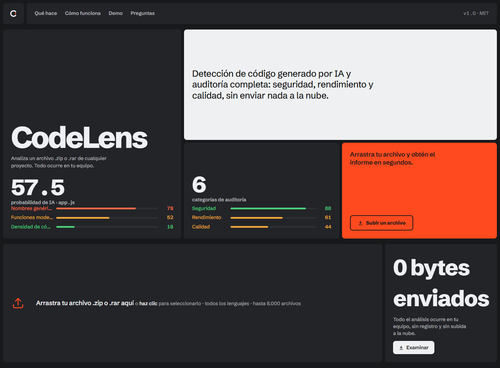
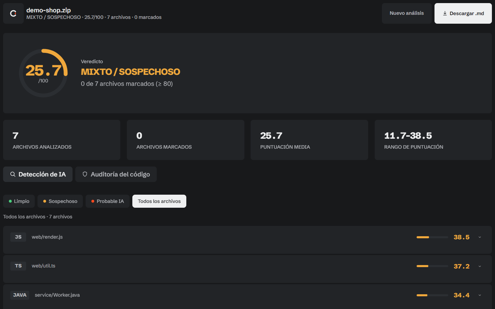
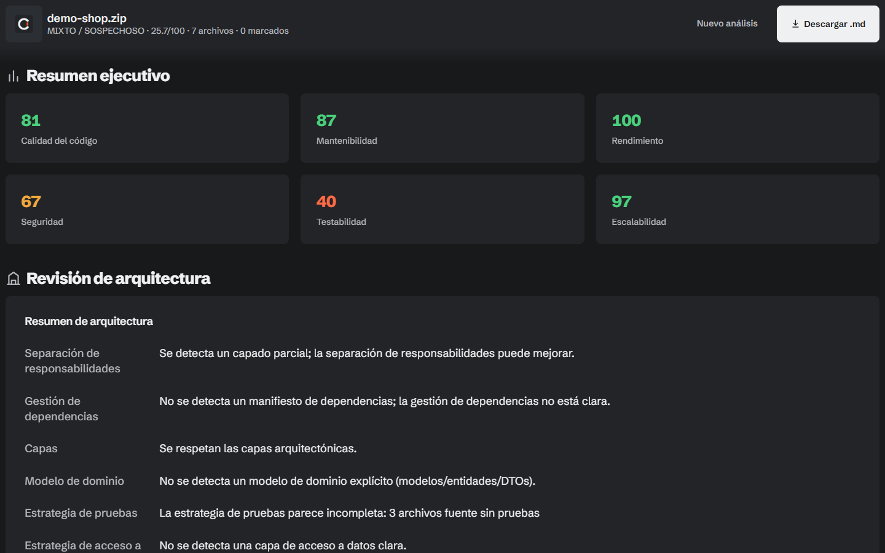
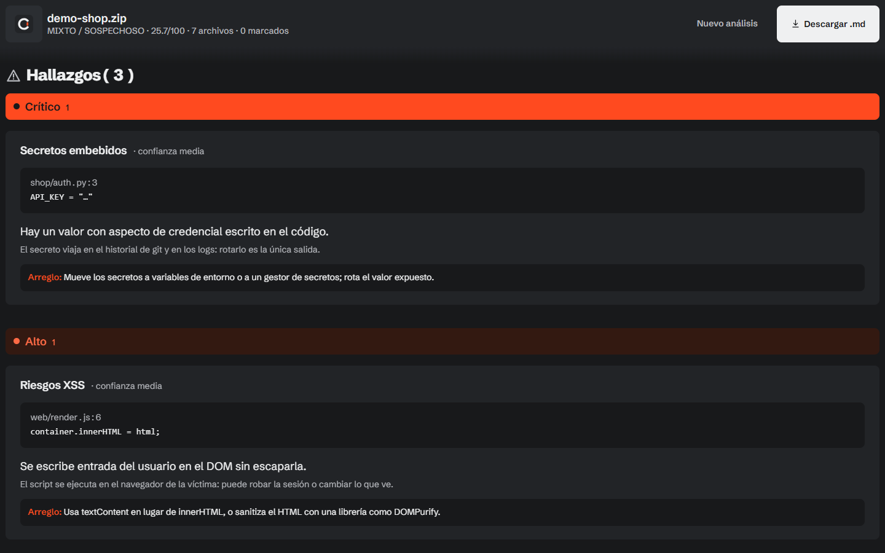

# CodeLens

**Suelta un `.zip` o un `.rar` de cualquier proyecto y en segundos sabrás qué
parte parece escrita por una máquina y qué está mal en el código.**

Sin cuenta, sin clave de API, sin subir el proyecto a ningún sitio. El archivo se
descomprime, se analiza y se borra en tu propia máquina. La interfaz carga la
tipografía Schibsted Grotesk desde Google Fonts.



## Resultados

- **Detección de IA, archivo por archivo.** Siete señales ponderadas producen una
  puntuación de 0 a 100 por archivo, un veredicto por archivo y un veredicto
  global del proyecto.
- **Auditoría del código.** Seis notas por categoría, una revisión de
  arquitectura, hallazgos estáticos (inyección SQL, XSS, consultas N+1, secretos
  embebidos, criptografía débil, excepciones silenciadas) y un plan de acción
  priorizado.
- **Un informe que puedes guardar.** Un clic descarga todo el análisis en
  Markdown.

## Arranque rápido

```bash
git clone https://github.com/fobicho/CodeLens.git
cd CodeLens
python server.py
```

El navegador se abre en `http://127.0.0.1:8000`. Arrastra un archivo a la página.

```bash
python server.py --port 9000       # otro puerto
python server.py --host 0.0.0.0    # exponerlo en tu red (lee Seguridad)
python server.py --no-browser      # no abrir el navegador
```

**Requisitos:** Python 3.8 o superior y nada más. El `.zip` funciona tal cual;
para `.rar` necesitas `pip install rarfile` y un backend como WinRAR/UnRAR o
`unrar` en el `PATH`.

## El informe

### Detección de IA

Cada archivo fuente se puntúa de 0 a 100. Con 80 o más se marca como
probablemente escrito por IA, entre 30 y 79 como sospechoso, y por debajo de 30
se lee como humano. El veredicto global del proyecto se calcula con la media y
usa sus propios umbrales, así que un archivo raro no condena un repositorio entero.



Cada fila se despliega en las siete señales que produjeron su puntuación, con el
motivo de cada una, para que un número nunca llegue sin argumento.

### Auditoría del código

Seis notas de 0 a 100, calculadas a partir de lo que los escáneres encontraron de
verdad y no del número de archivos.



Los hallazgos se agrupan **por arreglo, no por archivo**: nueve archivos con el
mismo error se convierten en una tarjeta que lista los nueve sitios, así no se
repite el mismo párrafo nueve veces. Cada hallazgo muestra la línea real del
código como evidencia (los secretos van enmascarados) y dice qué cambiar.



## Cómo se calcula la puntuación de IA

Cada señal se puntúa de 0 a 100 (más alto = más de máquina) y la puntuación final
es su media ponderada.

| Señal | Peso | Qué mira |
|---|---|---|
| Nombres genéricos | 22% | Proporción de identificadores típicos de IA (`data`, `result`, `temp`, `item`) |
| Densidad de código | 12% | Líneas con contenido frente a líneas en blanco y de solo llave |
| Comentarios | 12% | Muy pocos comentarios, o muchos que solo repiten el código |
| Consistencia de formato | 14% | Sangría anormalmente uniforme |
| Manejo de errores | 10% | Densidad de bloques `try`/`catch` defensivos |
| Estructura | 14% | Uniformidad en el largo de línea y patrones de espaciado |
| Uso de funciones modernas | 16% | Amplitud y densidad de recursos del lenguaje |

| Puntuación global del proyecto | Veredicto |
|---|---|
| ≥ 60 | Probablemente generado por IA |
| 25–59 | Mixto / sospechoso |
| < 25 | Probablemente escrito por un humano |

Son heurísticas, no pruebas forenses. Código humano con un estilo muy regular
puede puntuar alto, y código de máquina retocado a mano puede puntuar bajo. Toma
el número como un motivo para mirar, nunca como una prueba.

## Cómo funciona la auditoría

Siete escáneres estáticos recorren cada archivo. Se basan en expresiones regulares
y son agnósticos al lenguaje, que es lo que les permite funcionar sobre 51
extensiones sin un analizador por lenguaje — y también lo que los limita.

| Categoría | Busca |
|---|---|
| **Seguridad** | Inyección SQL, sumideros XSS, secretos embebidos, criptografía débil (MD5/SHA-1) |
| **Escalabilidad** | Patrones de consultas N+1, consultas dentro de bucles |
| **Observabilidad** | Bloques `catch` que se tragan el error sin registrarlo |
| **Calidad del código** | Llamadas inseguras (`eval`, `exec`, `pickle.loads`) |
| **Mantenibilidad** | Cobertura de pruebas, huecos de documentación |
| **Testabilidad** | Archivos fuente sin una prueba al lado |

La cobertura de pruebas se empareja por nombre, así que `tests/test_app.py` cubre
`app.py`, `FooTest.java` cubre `Foo.java`, `main_test.go` cubre `main.go` y
`Button.test.jsx` cubre `Button.jsx`.

El plan de acción ordena los hallazgos por severidad y esfuerzo, para que los
arreglos graves y baratos salgan primero.

## Cómo está montado

```
index.html ──POST /analyze (bytes crudos)──► server.py
                                                │
                                 extractor.py ──┤ descomprime, rechaza path traversal,
                                                │ recoge los archivos fuente
                                 detector.py  ──┤ siete señales por archivo
                                 audit.py     ──┤ escáneres, notas, plan de acción
                                                ▼
                     { report_id } ──► report.html?id=<token>
                                                │
                                           GET /report?id=<token>
```

El archivo y su contenido extraído se guardan temporalmente en tu máquina y se
borran al terminar el análisis. El informe queda en memoria bajo un token
aleatorio, se conservan los cuatro últimos y la página lo pide por token — así
recargar funciona y nada sobrevive a un reinicio.

| Archivo | Para qué sirve |
|---|---|
| `server.py` | Servidor HTTP, archivos estáticos, los dos endpoints |
| `extractor.py` | Descomprime `.zip`/`.rar`, evita zip-slip, lee las fuentes |
| `detector.py` | Las siete señales de IA y el veredicto |
| `audit.py` | Los escáneres, las notas, la revisión de arquitectura, el plan de acción |
| `index.html` | Página de inicio: toma el archivo y pasa el relevo |
| `report.html` | El informe: veredicto, estadísticas, archivos, auditoría, exportación a Markdown |
| `app.css` | El sistema de diseño que comparten las dos páginas |

## Seguridad

El servidor escucha en `127.0.0.1` por defecto, así que no es alcanzable desde tu
red.

- Las subidas exigen la cabecera `X-CodeLens: 1`, que una página de otro origen no
  puede poner sin un preflight que este servidor nunca responde — así que una web
  cualquiera no puede lanzar un análisis en tu localhost.
- Las subidas están limitadas a 256 MB y se rechazan antes de leer el cuerpo.
- Los miembros del archivo se escriben dentro de un directorio temporal con
  comprobación de ruta resuelta, así que entradas del tipo `../../etc/passwd` se
  rechazan en vez de extraerse.
- Los nombres de archivo que vienen de otros sistemas se sanean, porque un zip
  hecho en macOS puede contener legalmente caracteres que Windows rechaza.
- El código y los resultados no se envían a ninguna parte y no hay telemetría.
  La interfaz sí solicita la tipografía Schibsted Grotesk a Google Fonts.

`--host 0.0.0.0` expone el servidor a tu red sin autenticación. Hazlo solo en una
red de confianza.

## Límites

- Son heurísticas, no un sustituto de una herramienta SAST real ni de una revisión
  humana.
- El escáner de XSS marca cualquier `.innerHTML =`, incluidas las asignaciones
  seguras. Ahí hay falsos positivos.
- Lee como máximo 8000 archivos fuente por comprimido y salta los que pasan de
  1,5 MB. Cuando se detiene antes, el informe lo dice en vez de hacerse pasar por
  completo.
- La extracción está limitada a 20000 elementos y 512 MB de contenido expandido.
- Los directorios ignorados (`node_modules`, `dist`, `vendor`, `__pycache__`, etc.) no
  se analizan.
- Sin historial de git, sin auditoría de dependencias, sin flujo de datos entre
  archivos.

## Licencia

[MIT](LICENSE) © 2026 fobicho.

Las dos fotografías de `assets/` vienen de Wikimedia Commons: *Punch card with
Fortran*, de Tangopaso (dominio público), y *Macro circuit board*, de Ingo
Dierking (CC BY-SA 4.0). Los detalles completos están en `assets/credits.json`.
